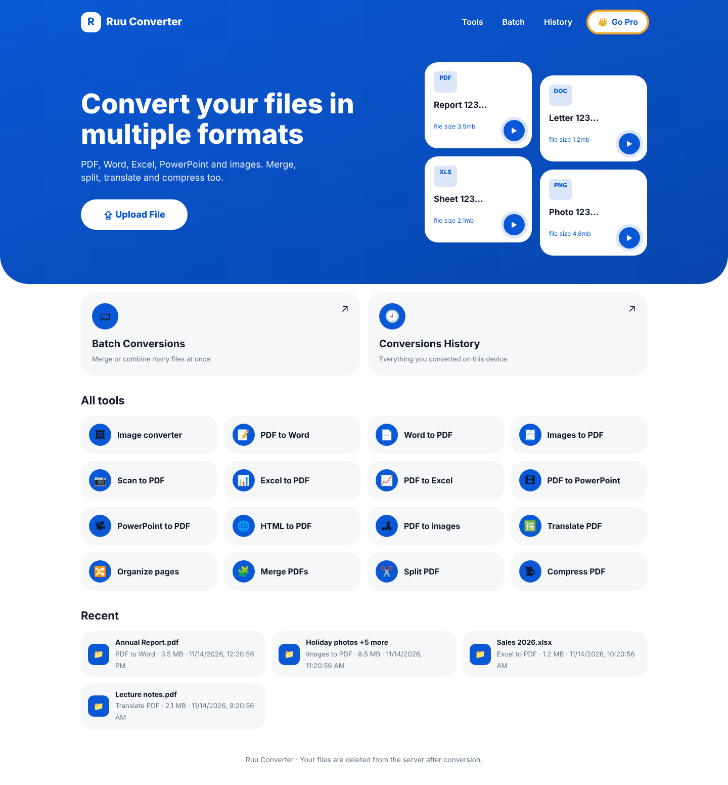
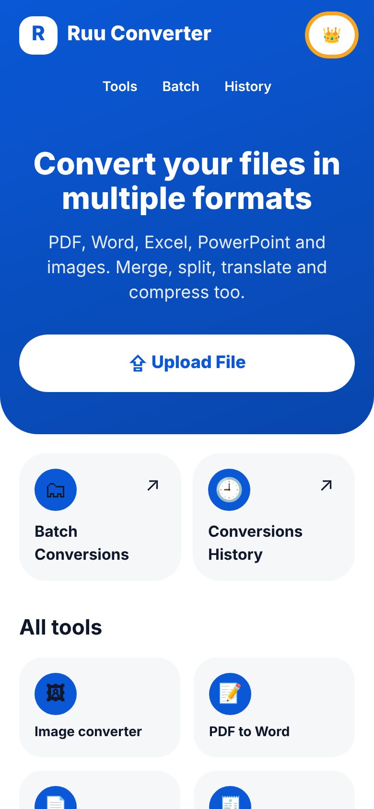

[README.md](https://github.com/user-attachments/files/34849312/README.md)
# Cloud File Converter

A full-stack file conversion web app. Upload a file, pick a tool, and download the result. The backend is a **FastAPI** service that handles 16 conversion and PDF tools. The frontend is a mobile-style **HTML, CSS and JavaScript** app with a clean blue interface.

## Screenshots

| Desktop | Mobile |
|---|---|
|  |  |
## Features

| Category | Tools |
|---|---|
| Documents | PDF to Word, Word to PDF, Excel to PDF, PDF to Excel, PDF to PowerPoint, PowerPoint to PDF, HTML to PDF |
| Images | Image format converter (PNG, JPG, WEBP, BMP, GIF), Images to PDF, Scan to PDF with contrast enhancement, PDF to images with page selection |
| PDF tools | Merge, Split (download links and ZIP), Organize pages, Compress |
| Language | Translate PDF between Sinhala, Tamil and English |

Other highlights:

- Drag and drop upload with a live progress bar
- Conversion history saved in the browser
- Magic-number file validation, safe unique filenames, automatic temp file cleanup
- Free limit of 25 MB, Rs. 25 micro-payment for larger files, 100 MB absolute limit
- Firebase authentication (optional login) and Firestore for user data
- PayHere payment integration (mock checkout included for local testing)

## Tech stack

- **Backend:** Python, FastAPI, PyMuPDF, pdfplumber, pdf2docx, docx2pdf, python-pptx, ReportLab, WeasyPrint, Pillow, pandas, deep-translator
- **Auth and data:** Firebase Admin SDK, Firestore
- **Payments:** PayHere
- **Frontend:** HTML, CSS, vanilla JavaScript (no framework)

## Project structure

```
backend/
  main.py              # FastAPI app and conversion endpoints
  database.py          # Firebase / Firestore setup
  routers/
    payment.py         # Checkout and PayHere webhook
    file_tools.py      # Size check + auth example endpoint
  utils/
    auth.py            # Firebase ID token verification
    security.py        # File validation, size limits, cleanup
frontend/
  index.html
  style.css
  app.js
```

## Getting started

### 1. Backend

```bash
cd backend
python -m venv venv
venv\Scripts\activate            # Windows
pip install fastapi uvicorn python-multipart pillow pymupdf pandas openpyxl \
  pdfplumber pdf2docx docx2pdf reportlab python-pptx weasyprint deep-translator \
  firebase-admin python-dotenv comtypes
```

Create a `.env` file in `backend/`:

```env
FIREBASE_CREDENTIALS_PATH=firebase_secret.json
PAYHERE_MERCHANT_ID=your_merchant_id
PAYHERE_MERCHANT_SECRET=your_merchant_secret
BASE_URL=http://localhost:8000
```

Put your Firebase service account file next to `main.py`, then run:

```bash
uvicorn main:app --reload
```

API docs are available at `http://localhost:8000/docs`.

### 2. Frontend

Open `frontend/index.html` in your browser. If the backend is not on `localhost:8000`, tap the crown icon and change the server address.

## API overview

All conversion endpoints accept `multipart/form-data` and return the converted file.

| Endpoint | Fields |
|---|---|
| `POST /convert/image` | `file`, `target_format` |
| `POST /convert/pdf-to-word` | `file` |
| `POST /convert/word-to-pdf` | `file` |
| `POST /convert/images-to-pdf` | `files` |
| `POST /convert/scan-to-pdf` | `files`, `enhance` |
| `POST /convert/excel-to-pdf` | `file` |
| `POST /convert/pdf-to-excel` | `file` |
| `POST /convert/pdf-to-pptx` | `file` |
| `POST /convert/pptx-to-pdf` | `file` |
| `POST /convert/html-to-pdf` | `file` |
| `POST /convert/pdf-to-selected-images` | `file`, `pages` (optional) |
| `POST /convert/pdf-translate` | `file`, `source_lang`, `target_lang` |
| `POST /convert/organize-pdf` | `file`, `new_order` |
| `POST /convert/merge-pdfs` | `files` |
| `POST /convert/split-pdf-links` | `file`, `split_ranges` (returns JSON with download links) |
| `POST /convert/compress-pdf` | `file` (Bearer token needed above 25 MB) |
| `POST /api/payment/create-checkout` | `user_id`, `amount` |

## Notes and requirements

- **Word to PDF and PowerPoint to PDF** use Microsoft Office through COM, so they work on **Windows with MS Office installed** only.
- **WeasyPrint** needs its system libraries (GTK/Pango). See the WeasyPrint installation guide.
- **Translate PDF** uses ReportLab, which does not shape Sinhala and Tamil text correctly yet. Output for these languages may look wrong.
- Never commit `.env` or `firebase_secret.json`. Add both to `.gitignore`.

## Roadmap

- Verify PayHere webhook signature and enforce payments on the server
- Move the Pro and micro-payment checks fully server-side
- Frontend login with Firebase
- Better Sinhala and Tamil PDF output for translation

## License

Add a license of your choice (for example MIT).
